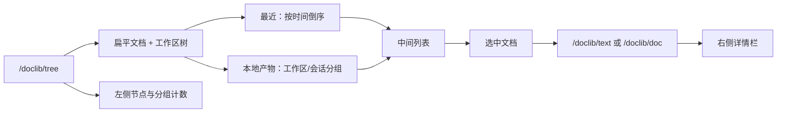

## 用户需求

把文档库主页面改成以本地文件为唯一组织来源的节点式页面：左栏展示「最近」「本地产物」两个节点，以及按工作区组织的「分组」；不再保留「我的文档」独立节点。点击文档后在右侧内嵌详情栏查看，不再使用弹窗。

## 产品概述

文档库是工作台中的本地文件索引页，数据来自会话产物、上传文件和本地目录。主页面需要让用户先按时间看到最新文件，再按工作区或会话查看产物归属，并在同一页面完成预览与继续工作。

## 核心功能

- 左侧节点：最近、本地产物、分组；分组按工作区列出，并显示文件数。
- 最近：全部本地文档按更新时间倒序的扁平列表，默认进入该节点。
- 本地产物：按「工作区 → 会话」分组的文档树；选择某个工作区时，只显示该组文档。
- 右侧详情：展示文件名、类型、大小、更新时间、来源、工作区、会话、位置；提供 Markdown 或文本预览，以及原文或排版切换、复制引用、下载原文、继续阅读任务、关闭。
- 保留类型筛选、搜索与返回目录、行勾选与添加到任务、重建索引。
- 上传文件仍出现在列表和详情中，但不再单独成节点。
- 从会话「文档」标签页进入时，仍自动定位并展开对应会话。
- 左侧节点和分组带有数量提示；详情栏只在有选中文档时出现，列表自动让位。

## 视觉

主体为三栏：约 196px 左栏、自适应列表、约 380px 详情栏。使用 1px 分隔线、海尔蓝选中条和轻量层级，不使用重卡片阴影。浅色与深色主题保持一致；面板较窄时，详情栏覆盖在列表右侧，仍可关闭并继续浏览。

## 技术栈选择

- 客户端 UI：React（宿主 `window.__ModuleLoader__.load` 注入，使用 `React.createElement`，无 JSX），单文件 `src/client/index.js`。
- 样式：单文件 `src/client/styles.css`，只使用宿主 `--dsw-alias-*` 主题变量，不新增依赖。
- 数据接口：沿用现有 `/doclib/status`、`/doclib/tree`、`/doclib/search`、`/doclib/text`、`/doclib/raw`、`/doclib/reindex`，不改 Host 端。
- 构建：`scripts/build-doclib-client.ts`，通过 `pnpm run build:doclib-client` 生成提交到仓库的 `client.js`，`pnpm run verify:doclib-client` 校验。
- 测试：Vitest web browser lane + Playwright，目标文件 `apps/web/tests/doclib-defaults.e2e.ts`。

## 实现策略

1. **保留外壳，替换主体**：顶部标题、索引统计、`重建索引`、类型筛选、搜索框保持不动；在工具栏下方新增三栏主体。
2. **客户端节点模型**：新增 `node` 状态，取值为 `recent`、`production` 或 `ws:<workspaceId>`，默认 `recent`。不新增接口，也不新增分组数据。
3. **数据派生**：

- 用 `allDocuments()` 把 `/tree` 扁平化为文档视图，补 `workspace`、`session`、`sessionId`。
- `recentDocs`：在类型筛选后按 `updatedAt` 倒序，缺失时间排最后，同时间按名称排序。
- `workspaceGroups`：来自 `tree.workspaces`，按可见文档计算数量；`分组` 节点直接消费该列表。
- 搜索结果继续使用现有 `/search` 返回，作为独立扁平列表。

4. **列表渲染复用**：保留现有 `documentRow`、`sessionBlock`、`workspaceBlock`；最近节点只渲染扁平行，本地产物节点渲染工作区与会话树，选中某个工作区时只渲染该工作区块。
5. **详情栏重构**：把 `DocumentDialog` 的正文加载、Markdown 渲染、原文切换、复制引用、下载逻辑抽成 `DocumentDetail`；去掉遮罩与弹窗壳，改挂到右侧栏。新增元数据区和「继续阅读任务」。
6. **现有流程接线**：

- `pendingPreview` 在树到达后改为选中详情，不再弹窗。
- `pendingSessionFocus` 改为把 `node` 切到 `production`，展开目标工作区与会话并滚动定位。
- 选择节点时清空搜索结果与关键词；`返回目录` 回到当前节点。
- 重新索引后若当前详情文档已不在新树中则清空，否则保留。

7. **样式与响应式**：新增左栏、三栏容器、详情栏样式；删除弹窗壳样式但保留 Markdown 样式。面板宽度不大于约 1024px 时详情栏改为覆盖层。

## 性能与可靠性

- 文档数量为 n：扁平化 O(n)，最近排序 O(n log n)，分组计数 O(n)；使用 `React.useMemo` 缓存派生结果，避免每次勾选都重新排序。
- 详情正文只在选中文档时请求一次 `/text`，失败回退 `/doc`；切换文档时用现有 alive 标记丢弃过期响应，不做列表级预取。
- 不产生 N+1 请求：`/tree` 只在加载或重建时请求，搜索只在提交时请求，详情只按需读取。
- 错误处理：`/text` 失败在详情栏展示错误；搜索失败沿用现有错误条；重建失败保留旧树；搜索命中缺少 `sessionId` 时隐藏「继续阅读任务」。
- 不触碰 `@` 引用 codec、composer bridge、会话「文档」入口注册和 Host 端索引逻辑，控制影响范围。

## 实施注意

- `client.js` 是生成物，禁止手改；改完 `src/client` 后必须重建并校验。
- 所有新样式使用 `--dsw-alias-*`，不硬编码新颜色；图标色调沿用现有 `DocIcon`。
- 左栏与列表的选中态沿用现有 inset 品牌色条，避免新增一套视觉语言。
- 面板较窄时，详情栏覆盖在列表上并保留关闭按钮；不挤压列表到不可读宽度。
- 原型 HTML 和 `.artifacts` 截图只作参考，不提交、不作为运行时依赖。
- e2e 中原先依赖 `role=dialog` 和「首次绘制展开会话」的断言必须同步改写，不能只改实现。

## 架构设计

现有插件是单客户端组件，不引入新架构模式，只在 `DocLibraryPanel` 内部拆分视图职责：

- `DocLibraryPanel`：持有 `tree`、`status`、`node`、`activeDoc`、`expanded`、`selection`、`results` 等状态。
- 左栏导航：由 `node` 和 `workspaceGroups` 渲染，不单独发请求。
- 中间列表：由 `recentDocs`、`workspaceGroups`、`results` 决定；复用现有行与分组组件。
- 右侧详情：由 `activeDoc` 驱动，按 `doc.key` 读取正文。
- 数据流：`/tree` → 扁平文档与工作区树 → 当前节点列表 → 选中文档 → `/text` → 详情预览。



## 目录结构

```
hi-buddy/
├── haiercash/builtin-plugins/hi-buddy-doclib-kit/
│   ├── src/client/index.js       # [MODIFY] 主面板重构：节点状态、最近/分组列表、右侧详情组件、会话定位、搜索与重建索引接线。
│   │                             # 保留现有 @ 引用、composer bridge、request/relativeTime/formatSize/classify/
│   │                             # renderMarkdown/documentRow/sessionBlock/workspaceBlock 等可复用实现。
│   ├── src/client/styles.css     # [MODIFY] 新增三栏容器、左栏节点、分组条目、右侧详情栏、窄宽度覆盖层样式；
│   │                             # 删除不再使用的弹窗壳样式，保留 Markdown 与按钮样式。
│   └── client.js                 # [REGENERATE] 由 build:doclib-client 生成的提交产物，禁止手改。
└── apps/web/tests/
    └── doclib-defaults.e2e.ts    # [MODIFY] 更新断言：两个节点与分组、默认最近、本地产物分组、
                                  # 右侧详情栏（非弹窗）、搜索/返回目录、文档标签页定位会话。
```

## 关键代码结构

```js
// DocLibraryPanel 新增的视图状态
node: 'recent' | 'production' | ('ws:' + workspaceId)
activeDoc: DocView | null        // 右侧详情栏的选中文档
recentDocs: DocView[]            // updatedAt 倒序，缺失时间排最后
workspaceGroups: Array<{         // 左侧「分组」与「本地产物」共用
  id: string,
  title: string,
  count: number,                 // 当前类型筛选下的可见文档数
  sessions: SessionView[]
}>

// 详情组件契约
DocumentDetail({ doc, onClose, onCopy, onOpenSession })
// doc 来自 /tree，含 name/kind/ext/size/updatedAt/rel/workspace/session/sessionId/key
```

## 验证

- `pnpm run build:doclib-client`
- `pnpm run verify:doclib-client`
- 构建 Web 资产后运行目标用例：`pnpm run test:web:built -- apps/web/tests/doclib-defaults.e2e.ts`
- 用例应覆盖：默认「最近」列表、左栏「最近/本地产物/分组」、工作区筛选、本地产物工作区→会话树、点击文档打开 `[data-doclib-detail]` 详情栏、Markdown 预览、搜索与返回目录、`文档` 标签页定位目标会话并展开。
- 通过 e2e 生成的 `library.png` 截图核对三栏比例、详情栏、空态和窄宽度覆盖效果。
- 不运行打包、桌面发布或其他无关 UI 的检查。

## 设计风格

沿用宿主的克制企业风格：三栏知识库、1px 细分割线、海尔蓝作为唯一强调色；不使用大面积卡片阴影或装饰插画。左栏负责定位，中间负责浏览，右栏负责阅读。

## 页面结构

- **顶部区**：保留「文档库」标题、索引统计和「重建索引」按钮，右侧留白，不新增标题层级。
- **工具栏**：类型筛选下拉、搜索框、`搜索` 与`返回目录` 按钮；高度与现有工具栏一致，不抢视觉重心。
- **左栏（约 196px）**：`最近`、`本地产物`两个节点，下方`分组`小节列出工作区。节点使用 16px 图标、单行省略名称、右侧计数胶囊；选中态为浅层底色加 2px 海尔蓝内嵌条，hover 使用宿主 layer-2 底色。
- **中间列表**：`最近`为扁平表格；`本地产物`为工作区→会话分组树，保留现有 28px 引导线和粘性表头。列保持名称、类型、工作区、时间、大小；搜索命中时切换为扁平结果并显示`返回目录`。
- **右侧详情栏（约 380px）**：仅在有选中文档时出现。顶部是 36px 文件块、文件名、`工作区 › 会话`面包屑和关闭按钮；操作行放`继续阅读任务`、`复制引用`、`下载原文`、`原文/排版`；元数据用两列键值网格展示类型、大小、更新时间、来源、工作区、会话、位置；下方是可滚动的预览区。
- **窄宽度**：面板宽度不大于约 1024px 时，详情栏从右侧覆盖列表，带轻阴影和关闭按钮；左栏保持可滚动，列表仍可继续操作。

## 交互

- 默认进入`最近`，文档按更新时间倒序；点击`本地产物`切换到分组树；点击某个工作区分组只显示该组。
- 点击文档行即选中并打开右侧详情，当前行保持 inset 品牌色条；关闭详情或按 Esc 回到列表全宽。
- 搜索提交后列表切为结果；选择任意节点会清空搜索并回到目录。
- 勾选、全选、`添加到任务`浮条位置与现有实现一致；详情栏打开时浮条仍居中于列表区域。
- 详情正文加载中、无文本、接口错误分别有明确占位；图片等无文本文件提示不可预览并保留下载入口。

## 视觉细节

- 面板背景使用宿主页面背景，左栏和详情栏使用 layer-1；只在中栏与右栏之间加 1px 分隔线，不用重边框。
- 空态使用居中图标和一行说明，不放大面积插画；分组计数使用小号胶囊，避免与主标题竞争。
- 详情栏进入使用 120ms 横向滑入；列表让位不做弹跳动画。