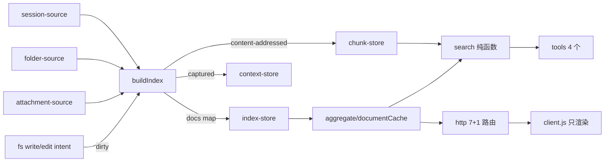

## 用户需求

阅读 `haiercash/builtin-plugins/doclib-impl-plan.md` 后，按文档落地 **P0 + P1** 两个分期，并把 1526 行的宿主 `index.js` 按文档 §4 全量拆成目录结构。交付仅源码 + 本地验证：不 bump 版本、不打 tgz、不更新打包 handoff。

已确认的边界：

- 评测集用仓库 `docs/` 目录（962 篇，脚本支持 `--root` 参数）。
- 拆分与数据改造分开提交，纯重构阶段的验收是「输出不变」。
- 不实现 P2 排序调优、P3 行号定位、P4 注入、P5 面板改版、P6 wiki。

## 产品概述

文档库当前把「出处（sessionId + 身份）」当主键，同一份文件被多个会话写过就会出现多行；目录扫描产出的文档 `path` 全是 `[object Object]`，导致按路径读取失败、按路径去重会把内容完全不同的文档聚成一篇。本轮把身份模型换成「位置当主键、内容当版本、出处降级为关系数组」，索引不再存正文，元数据按固有/关系/计算三类分别失效，并新建一层不可随索引重建而丢失的上下文事实日志。

## 核心功能

- **修目录文档路径**：`scanFolderDocs` 用 `path.resolve(rootPath, rel)` 产出真实路径；`doc_read({path})` 对未归档文档可读。
- **评测基线**：15 条查询一条命令输出 `hit@1 / hit@3 / dup@1`，默认跑仓库 `docs/`，可切 `--root`。
- **换主键**：唯一实现 `pathKey`（`wb:` / `attachment:` / `folder:` / `abs:`），同一物理文件只保留一条记录，`sessionIds` 记录全部出处。
- **索引 v3**：正文不进索引，按 `contentHash` 存放内容寻址分片；索引保留工作区/会话骨架用于面板分组。
- **增量与失效**：`mtime + size` 指纹命中即复用，只重读变化的文件；订阅 `fs/write-intent` / `fs/edit-intent` 标脏，写完立刻可搜。
- **上下文日志**：`<root>/.doclib/context.jsonl` 只追加 `captured / read`，重建索引不得触碰，支持从文档反查会话。
- **类型准入**：`doc | code | config | data`，检索默认不出 `code`。
- **宿主模块化**：`index.js` 只做装配，其余按 `shared / sources / index / search / store / tools / http` 归位。

## 视觉与交互效果

面板视觉不变：仍是「工作区 → 会话 → 文档」分组表格、搜索、行选择与 Markdown 预览弹窗。变化只体现在数据上——同一文件不再重复成多行，搜索结果与表格行数一致，行上可显示「N 个会话」角标；`client.js` 本轮不改。

## 技术栈

- 运行时：Node >= 24.9，ESM JavaScript（无 TypeScript、无新增依赖）。
- 宿主：Cordis 插件（`ctx.fs`、`ctx.tools`、`ctx.inject(['webServer'])`、`ctx.on('fs/write-intent' | 'fs/edit-intent')`）。
- 浏览器半：`client.js` 由 `packages/client/modules` 原样串成 combo 脚本执行，**不能拆分**（`prepareSource` 只去 sourcemap trailer，不重写 import；`tsdown.config.ts:23` 的 client workspace 不含本 kit）。
- 验证：kit 内独立 Node ESM 脚本（本 kit 不在 `vitest.config.ts` 的 include 内，`.oxlintrc.json` 也忽略 `*.js`）。

## 实施策略

### 1. 顺序（与 §7 对齐，每步结束插件都能跑）

1) 修 path bug + 抽 `shared/`（纯行为，输出不变）→ 2) 抽 `search/` 为纯函数 + 建评测集（排序输出逐字不变）→ 3) 抽 `sources/` + `index/` 同时换 v3（数据结构变更只在此步发生）→ 4) 抽 `store/` 并加上下文 → 5) 抽 `tools/` + `http/`，`index.js` 只装配 → 6) 审计与口径回写。

### 2. 索引 v3（在文档 §5.1 基础上的三处必要扩展，需回写文档）

```
{
  "version": 3,
  "generatedAt": 1794190870256,
  "mode": "sessions",
  "truncated": false,
  "workspaces": [
    { "id": "…", "title": "…", "path": "…",
      "sessions": [{ "id": "…", "title": "…", "createdAt": 0, "updatedAt": 0, "live": false, "error": null }] }
  ],
  "docs": {
    "wb:<workspaceId>/<rel>": {
      "pathKey": "wb:<workspaceId>/<rel>", "rel": "docs/architecture.md", "name": "architecture.md",
      "ext": ".md", "typeClass": "doc", "size": 12345, "lines": 312,
      "contentHash": "sha256:9f2c…", "fingerprint": "12345:1794190000000",
      "mtimeMs": 1794190000000, "kind": "generated", "workspaceId": "…",
      "sessionIds": ["s1", "s2", "s3"], "refs": ["docs/deploy.sh"],
      "chunkCount": 14, "searchable": true, "oversized": false
    }
  }
}
```

- **保留 `workspaces` 骨架**：`treePayload()` 与 `client.js` 依赖工作区/会话分组，去掉会让面板失去标题与层级；文档仍只在 `docs` 存一份。
- **新增 `abs:` 形式**：工作区外绝对路径文档（`outsideWorkspace`）用 `abs:<规范化绝对路径>`，与文档三种形式并列。
- **`key` 就是 `pathKey`**：工具与 HTTP 仍返回 `key` 字段（值换成 pathKey），`client.js` 已用 `encodeURIComponent`，无需改动。
- **文档 §5.1 写 `"v": 3`，实现沿用现有 `version` 字段**，避免 `loadIndex` 双字段判断；文档需同步改为 `version`。

### 3. pathKey 唯一实现

`shared/pathKey.js` 只导出 `pathKeyOf({ workspaceId, workspacePath, rootPath, absPath, rel, kind, attachmentId })`，内部按「最具体」优先级归一：`wb:` > `attachment:` > `folder:` > `abs:`。

- 目录扫描先算绝对路径，再看它是否落在某个已注册工作区路径下：是则产出 `wb:<id>/<rel to workspace>`，否则 `folder:<rel to root>`。这样「会话写的文件」与「目录扫到的同一文件」自然得到同一个 pathKey，无需额外按绝对路径合并。
- `attachment:<attachmentId>` 与根目录无关，会话附件不再按会话分裂。
- 工作区注册表变化会导致 pathKey 漂移：构建时比对 `workspaceId` 集合，不一致即触发整表重建（记录一条日志）。

### 4. 检索与正文分离（解开「索引不存正文」与「search 纯函数」的冲突）

- 正文分片按内容寻址落盘：`<root>/.doclib/chunks/<hash前2位>/<contentHash>.json`，内容 `{ version, contentHash, chunkLines, chunks:[{line,text}] }`；同内容不重写，全量重建结束后清理未被引用的分片。
- 冷启动只读 `index.json`（约 300–400 KB），不读正文、不建倒排。
- 首次搜索时按需读分片建倒排（惰性），随后驻内存；`search()` 仍是纯函数，接收 `chunksOf(pathKey)` 提供器，不碰 I/O。
- 增量：标脏 → 只重读该文件、写新分片、增量更新倒排；指纹未变的文档完全不读盘。
- 复杂度：全量重建 O(N) 次 stat + O(变化文档) 次读；搜索 O(query token 数 × 命中 posting 数)。

### 5. 标脏必须透明放行

`fs/write-intent` / `fs/edit-intent` 是单槽 waterfall，返回值本身就是决策（`createIfAbsent` / `replaceIfVersion`）。监听器只能**观察**：

```js
const decision = await next()
mark(target.targetKey)   // 只记录，不改变决策
return decision
```

返回 `undefined` 会吞掉别人的 version guard，必须原样回传。标脏按 `rootPath` + 已注册工作区路径前缀过滤，避免全仓库写入噪声；未索引路径的脏标记合并为一次防抖全量重建（≤1 次/2s）。

### 6. 上下文存储

- `<root>/.doclib/context.jsonl`，一行一事件 `{t,type,pathKey,sessionId,actor,detail}`；P1 只产生 `captured`（首次入库）与 `read`（`doc_read` 命中），`cited`/`distilled` 留接口不产生。
- 按天聚合是读取视图，不分文件。
- 写入目标守卫：`store/index-store.js` 每次写盘前调用 `assertNotContext(target)`，命中即抛错；另有脚本级校验：删除 `index.json` 重建前后 `context.jsonl` 的 SHA-256 必须一致。
- 反向查询：新增 `/context?pathKey=` 路由（不改 4 个模型工具）。

### 7. TTL 拆分

- `ttlSeconds` 默认从 120 改为 0（只按脏标记/指纹失效）；保留字段以兼容既有 profile。
- 固有元数据：`fingerprint = size:mtimeMs`，命中即复用；计算元数据：按 `contentHash` 失效；关系元数据：事件驱动，不进 TTL。

### 8. 与规划文档不一致、需在实现中纠正的三处

- **基线数字过时**：实测 962 篇 / 7824 块 / 10.88 MB / 962 条 path 全为 `[object Object]`，不是 70/638/835 KB/4 篇。验收改为：索引 ≥95% 小于 v2、单文档元数据 ≤400 B、冷启动在 962 篇上实测；`dup@1` 在单目录语料下天然为 0，另建合成用例验证聚合。
- **`locale/` 不是死引用**：`packages/boot/app-boot/src/package-meta.ts` 通过 `exports['./locale/*.json']` 读取 `meta.title/description`，删除会丢面板标题。P0 改为「验证 locale 生效」，不做删除。
- **`client.js` 不能拆分**：§4 的拆分只作用于宿主 `index.js`。

## 实施注意

- 索引装载仍是「形状不符即丢弃」，v3 需同时接受 v2 并内存迁移（v2 的假 path 用 `rel` 兜底、`contentHash` 置空以强制首次重读），保证回退分支可读。
- `root` 语义双关（本地文档目录 + fallback 扫描根），`.doclib/` 只能作为其子目录，不得改变 `root` 含义。
- 工具数量封顶 4 个，`doc_search` 不新增参数；隐藏 `code` 用配置项而非新 schema 字段。
- 避免 N+1：工作区/会话标题一次批量读取（沿用 `readTitleSnapshots`）；全量重建先 stat 后读，只读变化文件。
- 日志沿用宿主 logger，只记计数与耗时（重读文档数、分片命中数、索引大小、冷启动毫秒），不打印正文与绝对路径列表。
- 破坏面控制：`package.json` 的 `exports` / `files` 保持 `index.js` + `client.js` 入口不变（拆分模块放在 index.js 之后，属宿主内部）；本轮不打包，故不影响分发。

## 架构设计



六条硬边界照文档 §4 落地：`DocSource.collect()`、`DocRecord`、`buildIndex()` 唯一构建入口、`search()` 纯函数、`ContextLog` 只追加、`rules`（本轮不建，P4 再引入）。只经门面读下层。

## 目录结构

```
haiercash/builtin-plugins/hi-buddy-doclib-kit/
├── index.js                      # [MODIFY] 只做装配：Config、服务获取、注册 tools/http、订阅脏标记、预热索引（约 250 行）
├── client.js                     # [KEEP] 单文件不拆；面板视觉与交互不变
├── package.json                  # [MODIFY] 增加 scripts（eval/check），exports 与 files 入口不变
├── shared/
│   ├── pathKey.js                # [NEW] pathKey 唯一实现（wb/attachment/folder/abs 归一与解析）
│   ├── typeClass.js              # [NEW] 扩展名 → doc|code|config|data，默认隐藏 code 的策略常量
│   ├── hash.js                   # [NEW] sha256 文本哈希、指纹 size:mtimeMs 组合
│   └── doc-record.js             # [NEW] DocRecord 唯一形状：字段白名单、默认值、校验
├── sources/
│   ├── session-source.js         # [NEW] 会话扫描：附件 + write/edit 产出，产出 DocRecord 与工作区/会话骨架
│   ├── folder-source.js          # [NEW] 目录扫描：复用 ctx.fs 端口，修 path 假值，按工作区归属产 pathKey
│   └── attachment-source.js      # [NEW] 附件文本读取与分块，剥离自 index.js:423-471
├── index/
│   ├── build-index.js            # [NEW] 唯一构建入口：指纹复用、refs 两遍构建、脏路径定向更新、分片与索引落盘
│   ├── aggregate.js              # [NEW] 按 pathKey 聚合、sessionIds 去重合并；唯一的聚合点
│   ├── chunk.js                  # [NEW] 标题级切块（P1 保持现有按行），分片读写与 GC
│   ├── fingerprint.js            # [NEW] 指纹与 contentHash 失效判定
│   ├── refs.js                   # [NEW] 正文内相对路径引用提取，仅保留库内已知路径
│   └── dirty.js                  # [NEW] fs/write-intent、fs/edit-intent 透明放行 + 防抖标脏
├── search/
│   ├── tokenize.js               # [NEW] 现有 ASCII + CJK bigram 分词原样迁移（P1 不加停用词）
│   ├── postings.js               # [NEW] 倒排构建（接收 chunksOf 提供器，不碰 I/O）
│   └── rank.js                   # [NEW] 纯函数打分与结果组装，含 typeClass 过滤
├── store/
│   ├── index-store.js            # [NEW] index.json 读写、v2→v3 内存迁移、写目标守卫（不得碰 context）
│   ├── chunk-store.js            # [NEW] 内容寻址分片读写、未引用分片清理
│   └── context-store.js          # [NEW] context.jsonl 追加、按 pathKey 反查、assertNotContext
├── tools/
│   ├── index.js                  # [NEW] 聚合 4 个工具定义
│   ├── search.js                 # [NEW] doc_search（schema 不变，结果增加 pathKey，默认过滤 code）
│   ├── read.js                   # [NEW] doc_read（key 即 pathKey；path 先归一为 pathKey 再查）
│   ├── list.js                   # [NEW] doc_list（过滤维度不变）
│   └── status.js                 # [NEW] doc_status（计数改读 v3 字段）
├── http/
│   ├── routes.js                 # [NEW] 7 条既有路由 + /context 反向查询；tree 从 v3 派生
│   └── json.js                   # [NEW] JSON 响应辅助，剥离自 index.js:1520
├── scripts/
│   ├── eval.mjs                  # [NEW] 一条命令输出 hit@1/hit@3/dup@1，支持 --root/--queries/--json
│   ├── golden.mjs                # [NEW] --record/--check 固化 doc_search 输出，用于纯重构验收
│   ├── check-incremental.mjs     # [NEW] 改 1 个文件只重读 1 次；context.jsonl 重建前后 SHA-256 不变
│   └── lib/node-fs-port.mjs      # [NEW] 把 node:fs 适配成 ctx.fs 端口，供 eval/check 直接跑生产代码
└── evals/
    ├── queries.json              # [NEW] 15 条查询 + 期望 rel（中文/英文/标识符/短语/反例）
    └── baseline-docs.json        # [NEW] 仓库 docs/ 语料的基线指标与版本标记
```

不建 `inject/ compiler/ validator/ rules/` 空目录：P4/P6 再引入，避免空壳与误用。

## 关键契约

```js
// shared/pathKey.js
export function pathKeyOf(input: {
  kind: 'generated' | 'folder' | 'upload' | 'image'
  absPath?: string          // 工作区外或目录扫描得到的绝对路径
  rel?: string              // 相对 root 或工作区的路径
  rootPath?: string
  workspaceId?: string
  workspacePath?: string
  attachmentId?: string
}): string                  // 'wb:<id>/<rel>' | 'attachment:<id>' | 'folder:<rel>' | 'abs:<abs>'
export function pathKeyToRel(pathKey: string): string | null
```

```js
// index/build-index.js —— 唯一构建入口；返回可直接落盘的 v3 对象
export async function buildIndex(options: {
  sources: Array<{ collect(input): Promise<{ docs, workspaces?, truncated? }> }>
  previous?: object | null            // v2 或 v3 索引
  fs: FsPort                          // ctx.fs 或 node 适配器
  rootPath: string
  dirtyPaths?: string[]               // 定向更新；缺省为全量
  now?: number
  signal?: AbortSignal
}): Promise<{ index: object, stats: { reused, reread, chunks, added, removed } }>
```

## 验收口径（按 962 篇实测重定）

- P0：一条命令输出 `hit@1 / hit@3 / dup@1`；962 条 `path` 均为真实绝对路径；`doc_read({path})` 可读未归档文档。
- P1：索引体积相对 v2 下降 ≥95%（目标 ≤400 KB）；962 篇冷启动实测 ≤50 ms；首搜耗时单独记录；改 1 个文件 `readText` 调用次数 = 1；`context.jsonl` 重建前后 SHA-256 一致；合成用例中同一文件 3 个会话 → 1 条记录且 `sessionIds.length === 3`；`doc_search` 默认不出 `.ts/.js` 等 `code`。

## Agent Extensions

### SubAgent

- **code-explorer**
- Purpose: 宿主 `index.js` 拆成 7 个目录后，审计是否残留旧符号引用、重复实现（尤其 `pathKey`、`tokenize`、`chunkText`）与遗漏的 call site。
- Expected outcome: 输出一份残留引用与重复实现清单，确认拆分后无「第二份 pathKey」与断链导入。